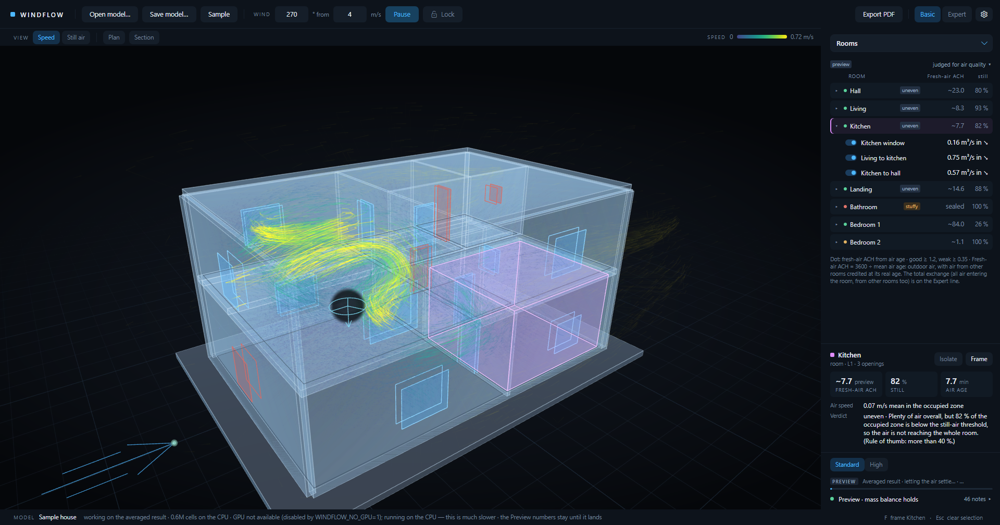

# WindFlow


WindFlow is a free Windows app that shows architects how wind moves air through their building, and how much fresh air each room gets.

**Move the window. See the air.**



> WindFlow is a design-stage airflow tool. Its results are estimates with stated uncertainty, not a substitute for a ventilation engineer or a code-compliance calculation.

## What it does

- Opens a building model, or the built-in sample house.
- Lets you set the wind direction and speed.
- Shows the air moving through the building, live.
- Gives each room a fresh-air number, and tells you if a room is stuffy, draughty or uneven.
- Lets you open and close windows and doors and see the result straight away.
- Lets you edit rooms and openings, and save a PDF report.

More detail: [docs/USING_THE_APP.md](docs/USING_THE_APP.md).

## Download / run

There is no public download yet. For now, build it from source (see below).

<!-- TODO(owner): add the download link here once a release is published. -->

When you want an installer, run `pack.ps1`. It builds one into `out/releases`. It needs the `vpk` tool: `dotnet tool install -g vpk`.

## Get started with Claude Code

Open this folder in Claude Code and paste:

```text
Build WindFlow with `dotnet build WindFlow.sln -c Release`.
Fix any build errors. Then run the app with
`dotnet run -c Release --project src/WindFlow.App`.
When the window opens, click "Sample" to load the sample house, set a wind
direction and speed, and click "Run". Tell me what you see.
```

## Quick start (manual setup)

You need the .NET SDK and a Windows PC (see Requirements).

```bash
dotnet build WindFlow.sln -c Release
dotnet run -c Release --project src/WindFlow.App
```

Then click **Open model...** (a `model.json` file) or **Sample**. Set the wind and click **Run**.

## Requirements

- Windows, 64-bit. TODO(owner): state the minimum Windows version; the project files do not say.
- .NET SDK 10 for the app (`net10.0-windows`). The other projects use .NET 8.
- A graphics card. An NVIDIA card (CUDA) is recommended. Without one, WindFlow runs on the CPU, which is slower.
- Disk and RAM: not stated anywhere in the project yet. TODO(owner).

## How accurate is it?

Use WindFlow to compare design options on the same model: "does this window help more than that one?" It is less good at giving one exact number.

- One room: a small change in grid size can move its number by up to about 35 %.
- The whole building: by about 20 %.
- **Standard** (steady wind) headlines the age followed through time (online, with the turbulent mixing) in each room where it settled, and falls back to the steady age, marked "steady age", in a room where it did not. Standard switches a room to the online age only when that room's online age has settled within the run's time budget; on a ~5 M cell grid this typically needs 30-50 min of run time, so shorter runs mostly report the steady age (marked "steady age"). The steady age can differ from the age followed through time by about 30 % either way per room: lower in slowly recirculating rooms, higher in fast-flushed ones. Fresh-air ACH = 3600 / mean age equals an air-change rate only when the room's air is fully mixed; otherwise it is the room's mean-age equivalent (Etheridge & Sandberg 1996; Hurraß 2026). **High** (gusty wind) headlines the age followed through the gusts and shows the steady-age value beside it; that value ignores gust mixing and usually reads lower (up to about 3 times), but not in every room.

Not checked yet: fresh-air numbers against real tracer-gas measurements, and heated rooms (one heat test still fails).
Read the full list in [docs/LIMITATIONS.md](docs/LIMITATIONS.md) and the test results in [VALIDATION.md](VALIDATION.md).

## How it works (short)

WindFlow splits the air around and inside the building into many small cubes. It then works out, step by step, how air moves from cube to cube (a "lattice-Boltzmann" solver). It can run on the graphics card for speed. You see the result as moving particles.

More: [docs/HOW_IT_WORKS.md](docs/HOW_IT_WORKS.md). Command-line options and the Revit export: [docs/CLI.md](docs/CLI.md).

## Project layout

| Project | What |
|---|---|
| `src/WindFlow.App` | The desktop app: window, 3D view, live solver, results, exports. |
| `src/WindFlow.Core` | The solver and analysis. Knows nothing about Revit or the window. |
| `src/WindFlow.Sandbox` | Test buildings and the physics check suite. |
| `src/WindFlow.Viz` | Plan and section images for the report. |
| `src/WindFlow.Report` | PDF report generation. |
| `src/WindFlow.Revit` | Small Revit exporter that writes `model.json`. |

## License

WindFlow is free and open source under the [GNU AGPL v3](LICENSE). You can use it, change it and share it. If you share a changed version, or run one as an online service, you must publish your changes under the same licence.

Want to build WindFlow into a closed-source product? A commercial licence will be available later. Contact the owner.

Third-party licences: [THIRD-PARTY-NOTICES.txt](THIRD-PARTY-NOTICES.txt).

The list of bundled packages is in [docs/LICENSES.md](docs/LICENSES.md).

## Contributing

Bug reports and ideas are welcome as issues. Outside code contributions (pull requests) are not accepted for now, so that a commercial licence can be offered later.
